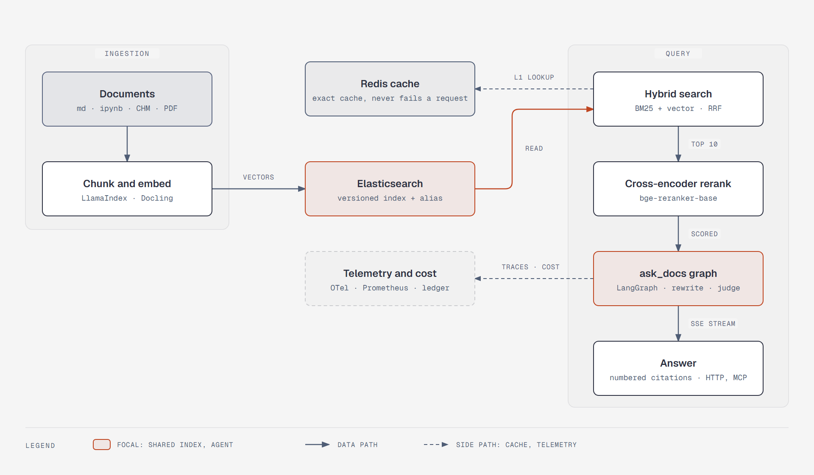
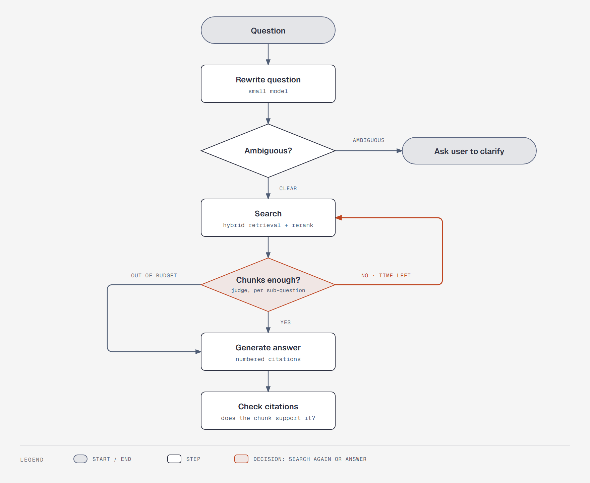

# rag-platform

A multi-knowledge-base RAG platform built the way a production system is built: hybrid retrieval, an agentic answer graph, citations that are checked, a cost ledger, observability, and an evaluation harness whose numbers come with confidence intervals and stated limits.

[](LICENSE)


**Stack:** Elasticsearch 9 (BM25 + vector) · application-level RRF · cross-encoder rerank · LlamaIndex ingestion · LangChain model calls · LangGraph agent · MCP and HTTP search service · Redis cache · OpenTelemetry, Prometheus, Grafana, Jaeger, Langfuse · Docling for PDF and images.

## Highlights

- **Retrieval you can measure.** On 99 development questions over the Hugging Face docs (2,647 documents, 26,372 chunks), hybrid search with rerank reaches Hit@1 0.788 and MRR@8 0.841; on 100 held-out questions that were never used for tuning, Hit@1 is 0.720 and Hit@8 is 0.890. Without the rerank step it is 0.616 and 0.747.
- **Agentic RAG, tested against plain RAG.** On 25 hard questions the agent graph answers 16 correctly against 10 for single-pass RAG (paired McNemar test, p = 0.031). On simple questions it does not do worse. It costs 4.1 times more per question and does not meet its latency target. Both facts are in the results below.
- **A judge that was checked.** The LLM judge agrees with human labels with a weighted kappa of 0.886 (1 to 3 scale, 50 rows) before its scores are used for anything.
- **Cost under control.** Every model call goes through a ledger with a budget stop. Ingesting the whole corpus with real embeddings took 41 minutes, 5.2 M embedding tokens and 2.60 CNY.
- **Failure modes designed in.** Index versions with alias switch and rollback, a 5 percent failure stop on ingestion, a cache that never fails a request, a circuit breaker on the model gateway, and a prompt-injection test set.
- **Spec-driven history.** 40+ sub-requirements, each with a spec, a report and a progress line: [docs/plan.md](docs/plan.md), [docs/progress.md](docs/progress.md), [docs/reports/](docs/reports/).

## Architecture



### The `ask_docs` graph

The diamond is the sufficiency judge: it checks whether the retrieved chunks answer every sub-question of the user's question, using the rerank score where that settles it and a small model where it does not.



## Results

All numbers come from reports in this repository, and the report is named in each table. Hit@k is the share of questions whose gold page is among the top k pages; MRR@8 is the mean of one over the rank of the first gold page, counting 0 when it is missing. Intervals are 95 percent Wilson intervals. Small samples are noted where they matter.

### Retrieval (99 development questions, Hugging Face docs)

| Configuration | Hit@1 | MRR@8 | Median latency | Source |
|---|---|---|---|---|
| BM25 + vector, RRF, no rerank | 0.616 | 0.747 | 32 ms | [P2](docs/reports/P2-report.md) |
| BM25 + vector, RRF, rerank 10 chunks (**current**) | **0.788** (0.70 to 0.86) | **0.841** | 2,987 ms (p95 3,694 ms) | [P2](docs/reports/P2-report.md) |
| Rerank on, BM25 only | 0.747 | 0.810 | | [P2](docs/reports/P2-report.md) |
| Rerank on, vector only | 0.717 | 0.768 | | [P2](docs/reports/P2-report.md) |
| Current configuration on 100 **held-out** questions | 0.720 (0.63 to 0.80), Hit@8 0.890 | | | [P1-05](docs/reports/P1-05-report.md) |

Rerank adds 17 points of Hit@1 at the price of about three seconds on CPU; switching it off made 20 questions worse and 3 better (p = 0.0005, [P2](docs/reports/P2-report.md)), the only component whose removal was clearly reliable. Using one search path instead of both loses 4 to 7 points of Hit@1, but at 99 questions the Hit@1 difference is not statistically reliable (p = 0.22 for BM25 only, 0.065 for vector only); the paired MRR and nDCG tests lean the same direction. The held-out set is 100 different questions kept out of every tuning decision. Its Hit@1 is about 7 points lower than the development set, so the comparison is only a check that tuning did not overfit, not a paired test ([P0](docs/reports/P0-report.md), [P1-05](docs/reports/P1-05-report.md)).

### Agentic RAG against single-pass RAG (150 questions, one run each)

| Question type | Questions | Single-pass RAG correct | `ask_docs` correct | Reading |
|---|---|---|---|---|
| Single-hop | 65 | 64 | 64 | no difference, no regression |
| Two-hop | 20 | 15 | 16 | direction favors `ask_docs`, not significant |
| Colloquial | 15 | 15 | 13 | direction favors single-pass, not significant (15 questions) |
| Questions with no answer: refused | 50 | 50 | 50 | both refuse; 5 `ask_docs` refusals were run errors, not clean refusals |

Source: [P3 report, section 3](docs/reports/P3-report.md). On the harder question set added later, `ask_docs` correct on 16 of 25 against 10 of 25, six questions better and none worse, p = 0.031 ([eval-upgrade report](docs/reports/eval-upgrade-report.md)).

### Cost and latency

| | Single-pass RAG | `ask_docs` |
|---|---|---|
| Model calls per question | 0.83 | 3.27 |
| Cost per question | 0.0040 CNY | 0.0162 CNY (4.1 times) |
| Median latency | 5.6 s | 13.4 s |
| 95th percentile | 7.8 s | 20.9 s (target 15 s: **not met**) |
| Over the 30 s limit | 0 of 150 | 0 of 150 |

### Stability, judge and cache

| What | Result | Source |
|---|---|---|
| Three runs of the same 75 questions: correct in all three runs | `ask_docs` 47, single-pass 45; the gap is inside the run-to-run noise of up to 7 questions | [eval-upgrade](docs/reports/eval-upgrade-report.md) |
| LLM judge against human labels, 1 to 3 scale | weighted kappa 0.886, 49 of 50 exact. The AI judged first and a person then checked each row, so the true agreement may be lower | [human-agreement](docs/reports/human-agreement.md) |
| Sufficiency judge inside `ask_docs`, 234 questions | 94.4% correct (90.7% to 96.7%); rerank score alone 82.5% | [P3](docs/reports/P3-report.md) |
| Citations and injection | 64 of 64 answers had a valid citation on every sentence; of 30 prompt-injection questions, 29 complied with the rules, 0 broke them, 1 timed out | [progress P1-04](docs/progress.md) |
| Exact cache (L1) | 0 false hits on 474 near-miss question pairs; all 100 equivalent pairs share one entry | [P5](docs/reports/P5-report.md) |
| Model selection (rerank, answer, embedding) | no replacement beat the current choice reliably; each decision and its trade-off is written down | [P7](docs/reports/P7-report.md) |

## Known limits

Written down because a reader will find them anyway:

- The 15 s p95 target for `ask_docs` is missed. The rewrite step runs on nearly every question and showed no retrieval gain on this set, so it is the first candidate to cut.
- The "search again" loop rarely runs under the default time budget: only 3 of 100 answerable questions took a second round.
- Colloquial questions, hard questions and ambiguous questions were written by hand from earlier failures. Results on them describe those types, not real traffic.
- One public corpus. The private knowledge bases (a vendor manual, PDFs) are configured but their contents are not in the repository.

## Quick start

Needs Docker and [uv](https://docs.astral.sh/uv/). This path uses fake embeddings: it calls no model and costs nothing, but retrieval quality means nothing in this mode. It only shows that the pipeline runs.

```bash
uv sync
scripts/dev_up.sh                                                   # Elasticsearch, Redis, OTel collector, Jaeger
uv run python -m rag.index.cli init --kb hf_docs
uv run python -m rag.ingest.job --kb hf_docs --limit 50 --fake-embed
uv run pytest                                                       # unit tests, no network
```

For real embeddings and chat models, copy `.env.example` to `.env` and fill in the gateway settings. Those runs spend money against the budget in the cost ledger.

## Documentation

| Read | For |
|---|---|
| [docs/usage.md](docs/usage.md) | Running and operating it: services, ingestion, models and cost, search API, `ask_docs`, cache, monitoring, production guards, evaluation commands |
| [docs/design/rag-platform-design.html](docs/design/rag-platform-design.html) | The design (Chinese), with a section index in [docs/design/README.md](docs/design/README.md) |
| [docs/decisions.md](docs/decisions.md) | Decisions and the reasons for them |
| [docs/reports/](docs/reports/) | One report per phase: P0 retrieval, P1 answering, P2 ablations, P3 agent, P4 private knowledge base, P5 cache and monitoring, P6 PDF and images, P7 model selection, P8 production readiness, evaluation upgrade |
| [specs/](specs/) | The spec behind every sub-requirement |

## License

[MIT](LICENSE). The question set in `evals/datasets/hf_docs/` is derived from the Apache-2.0 dataset `m-ric/huggingface_doc_qa_eval`; see its [NOTICE](evals/datasets/hf_docs/NOTICE.md).
