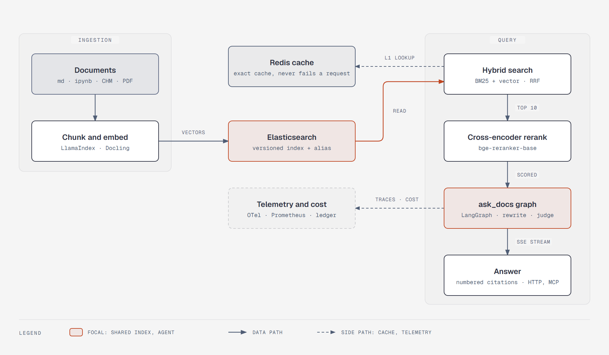
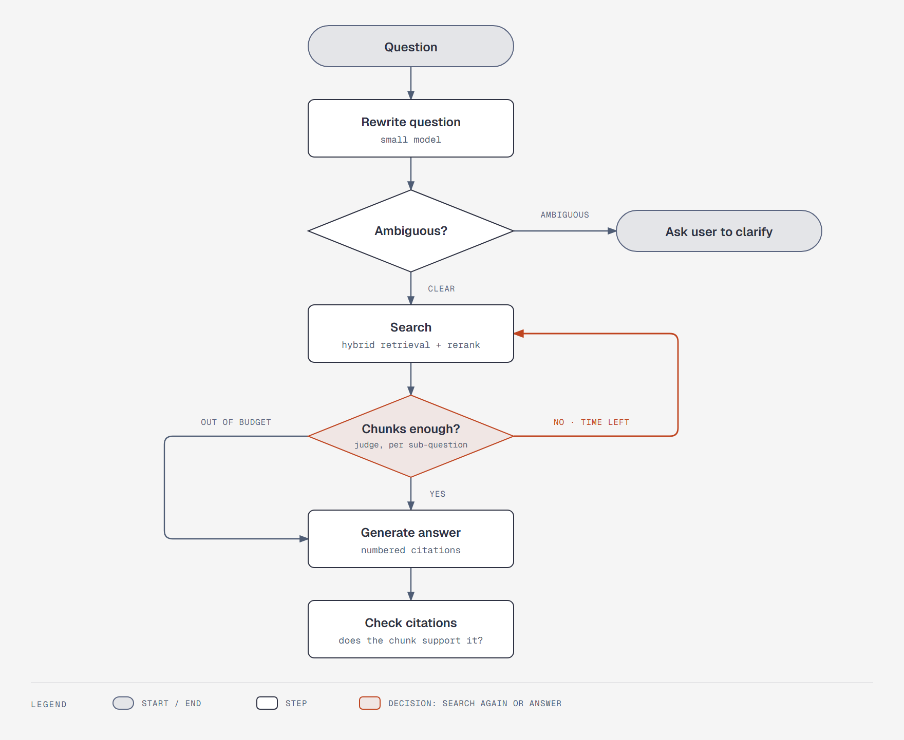

# rag-platform

[English](README.md) | 简体中文

这是一个支持多个知识库的 RAG（Retrieval-Augmented Generation，检索增强生成：先从资料里检索出相关片段，再让大模型根据片段回答）平台。它按生产系统的标准来做：混合检索、带判断环节的智能体回答流程、会被核对的引用、成本账本（记录每次模型调用花了多少钱的文件）、可观测性，以及一套评测工具。评测结果都带置信区间，并且写明了结论适用的范围。

[](LICENSE)


**技术栈：** Elasticsearch 9（BM25 关键词检索加向量检索）· 应用层做的 RRF 融合（Reciprocal Rank Fusion，倒数排名融合：把两路检索的名次合并成一个名次）· 交叉编码器重排（cross-encoder rerank：把问题和每个片段放在一起重新打分）· LlamaIndex 负责摄取 · LangChain 负责调用模型 · LangGraph 编排智能体 · MCP（Model Context Protocol，模型上下文协议）和 HTTP 两种检索接口 · Redis 缓存 · OpenTelemetry、Prometheus、Grafana、Jaeger、Langfuse 负责监控和追踪 · Docling 负责解析 PDF 和图片。

## 亮点

- **检索效果有数字可查。** 在 Hugging Face 文档上（2,647 篇文档，26,372 个片段），用 99 道开发集题测试，混合检索加重排的 Hit@1 是 0.788，MRR@8 是 0.841。另外有 100 道没有参与过任何调参的保留集题，Hit@1 是 0.720，Hit@8 是 0.890。不做重排时，开发集上这两项分别是 0.616 和 0.747。
- **智能体回答和单次回答做过对比。** 在 25 道难题上，`ask_docs` 智能体流程答对 16 题，只检索一次再回答的普通 RAG 答对 10 题（配对 McNemar 检验，p = 0.031）。在简单题上，智能体流程没有变差。代价是每道题的成本是普通 RAG 的 4.1 倍，并且没有达到事先定的延迟目标。这两点都写在下面的结果里。
- **打分用的大模型裁判被核对过。** 在回答质量这项上，大模型裁判和人工标注的加权 kappa 是 0.886（1 到 3 分制，50 行样本）。先做了这项核对，才使用裁判的分数。
- **成本有上限。** 每次调用模型都要经过成本账本，超出预算就停止。用真实向量模型摄取整个文档集，用了 41 分钟，消耗 520 万个向量词元（token），花费 2.60 元。
- **出错的情况有设计。** 索引分版本，别名可以切换，也可以回滚；摄取时失败的文档超过 5% 就停止；缓存出问题时不会让请求失败；模型网关有熔断；另外有一组提示词注入的测试题。
- **每个子需求都有记录。** 一共 40 多个子需求，每个都有 spec（需求说明）、报告和进度记录：[docs/plan.md](docs/plan.md)、[docs/progress.md](docs/progress.md)、[docs/reports/](docs/reports/)。

## 架构



### `ask_docs` 的处理流程

图中的菱形是“够不够”判断。它检查检索到的片段能不能回答用户问题的每一个子问题：重排分数能直接说明问题的，就用分数判断；说明不了的，再交给一个小模型判断。



## 结果

下面所有数字都来自本仓库里的报告，每张表都标出了对应的报告。几个指标的意思：Hit@k 是“标准答案所在页面出现在前 k 个页面里”的题所占的比例；MRR@8 是标准答案页面第一次出现的名次的倒数，对所有题取平均，没出现的题按 0 算。区间都是 95% 的 Wilson 置信区间。样本少的地方，文中都写了。

### 检索（99 道开发集题，Hugging Face 文档）

| 配置 | Hit@1 | MRR@8 | 延迟中位数 | 出处 |
|---|---|---|---|---|
| BM25 加向量，RRF 融合，不重排 | 0.616 | 0.747 | 32 毫秒 | [P2](docs/reports/P2-report.md) |
| BM25 加向量，RRF 融合，重排 10 个片段（**当前配置**） | **0.788**（0.70 到 0.86） | **0.841** | 2,987 毫秒（第 95 百分位 3,694 毫秒） | [P2](docs/reports/P2-report.md) |
| 开着重排，只用 BM25 | 0.747 | 0.810 | | [P2](docs/reports/P2-report.md) |
| 开着重排，只用向量 | 0.717 | 0.768 | | [P2](docs/reports/P2-report.md) |
| 当前配置，在 100 道**保留集**题上 | 0.720（0.63 到 0.80），Hit@8 是 0.890 | | | [P1-05](docs/reports/P1-05-report.md) |

重排使 Hit@1 提高了 17 个百分点，代价是在 CPU 上多花约 3 秒。关掉重排以后，有 20 道题变差，3 道题变好（p = 0.0005，见 [P2](docs/reports/P2-report.md)）。在各个组件里，只有重排被关掉后的变差是可靠的。只用一路检索而不是两路都用，Hit@1 会少 4 到 7 个百分点，但在 99 道题上，这个 Hit@1 的差别在统计上不可靠（只用 BM25 的 p 是 0.22，只用向量的 p 是 0.065）。配对检验的 MRR 和 nDCG 也朝同一个方向偏。保留集是另外 100 道题，没有参与任何调参的决定。它的 Hit@1 比开发集低约 7 个百分点。这个对比只能用来检查调参有没有过拟合，不是配对检验（见 [P0](docs/reports/P0-report.md)、[P1-05](docs/reports/P1-05-report.md)）。

### 智能体回答和单次回答的对比（150 道题，每题各跑一遍）

| 题型 | 题数 | 普通 RAG 答对 | `ask_docs` 答对 | 怎么理解 |
|---|---|---|---|---|
| 单跳题（答案在一个页面里） | 65 | 64 | 64 | 没有差别，也没有变差 |
| 两跳题（要连着查两个页面） | 20 | 15 | 16 | 方向上 `ask_docs` 好，但差别不显著 |
| 口语化的题 | 15 | 15 | 13 | 方向上普通 RAG 好，但差别不显著（只有 15 道题） |
| 没有答案的题：拒绝回答的数量 | 50 | 50 | 50 | 两边都拒绝回答；`ask_docs` 的 5 次拒绝其实是运行出错，不是干净的拒绝 |

出处：[P3 报告第 3 节](docs/reports/P3-report.md)。后来加的难题集上，`ask_docs` 在 25 道题里答对 16 道，普通 RAG 答对 10 道，6 道题变好、0 道题变差，p = 0.031（见[评测升级报告](docs/reports/eval-upgrade-report.md)）。

### 成本和延迟

| | 普通 RAG | `ask_docs` |
|---|---|---|
| 每题平均调用模型的次数 | 0.83 | 3.27 |
| 每题成本 | 0.0040 元 | 0.0162 元（是前者的 4.1 倍） |
| 延迟中位数 | 5.6 秒 | 13.4 秒 |
| 第 95 百分位延迟 | 7.8 秒 | 20.9 秒（目标是 15 秒，**没有达到**） |
| 超过 30 秒总时限的题数 | 150 题里 0 题 | 150 题里 0 题 |

### 稳定性、裁判和缓存

| 项目 | 结果 | 出处 |
|---|---|---|
| 同样的 75 道题各跑 3 遍，三遍都答对的题数 | `ask_docs` 是 47 题，普通 RAG 是 45 题；这个差别在运行之间的波动范围内，波动最多有 7 题 | [评测升级报告](docs/reports/eval-upgrade-report.md) |
| 大模型裁判和人工标注的一致程度（1 到 3 分制） | 加权 kappa 是 0.886，50 行里有 49 行完全一致。标注是 AI 先做出判断、人再逐行检查的，所以一致率可能比两边各自独立判断时高 | [human-agreement](docs/reports/human-agreement.md) |
| `ask_docs` 里的“够不够”判断，234 道题 | 判断正确率 94.4%（区间 90.7% 到 96.7%）；只看重排分数判断的正确率是 82.5% | [P3](docs/reports/P3-report.md) |
| 引用和提示词注入 | 64 个回答的每一句都带有效引用；30 道提示词注入题里，29 道符合规则，0 道违反规则，1 道超时 | [进度记录 P1-04](docs/progress.md) |
| 精确缓存（L1） | 474 对相近但不同的问题里，缓存没有误命中任何一对；100 对写法不同但意思相同的问题，全部共用同一个缓存条目 | [P5](docs/reports/P5-report.md) |
| 模型选型（重排、回答、向量） | 没有可靠地比当前选择更好的替代模型；每个决定和它的取舍都写在报告里 | [P7](docs/reports/P7-report.md) |

## 已知的局限

这些局限写在这里，是因为读的人迟早会发现：

- `ask_docs` 的第 95 百分位延迟目标 15 秒没有达到。几乎每道题都会先改写问题，但在这批题上，改写没有带来检索效果的提升，所以它是第一个该考虑去掉的步骤。
- 在默认的时间预算下，“再检索一次”的回路很少真正运行：100 道有答案的题里，只有 3 道进入了第二轮。
- 口语化的题、难题和含糊的题，都是我照着以前的失败情况手写的。这些题上的结果，只能说明这几类题的情况，不能代表真实的用户流量。
- 只用了一个公开文档集。私有知识库（一份厂商手册和一些 PDF）已经配置好，但它们的内容不在仓库里。

## 快速开始

需要安装 Docker 和 [uv](https://docs.astral.sh/uv/)。下面这条路径使用假向量：它不调用任何模型，不花钱，但在这种模式下，检索质量的数字没有意义，只能用来验证整条流程能从头到尾运行。

```bash
uv sync
scripts/dev_up.sh                                                   # 启动 Elasticsearch、Redis、OTel Collector、Jaeger
uv run python -m rag.index.cli init --kb hf_docs
uv run python -m rag.ingest.job --kb hf_docs --limit 50 --fake-embed
uv run pytest                                                       # 单元测试，不需要网络
```

要使用真实的向量模型和对话模型，把 `.env.example` 复制成 `.env`，再填入模型网关的设置。这样运行会花钱，花费受成本账本里的预算限制。

## 文档

| 要读的文件 | 内容 |
|---|---|
| [docs/usage.md](docs/usage.md) | 怎么运行和维护：服务、摄取、模型和成本、检索接口、`ask_docs`、缓存、监控、生产环境的保护措施、评测命令（英文） |
| [docs/design/rag-platform-design.html](docs/design/rag-platform-design.html) | 设计文档（中文），章节目录见 [docs/design/README.md](docs/design/README.md) |
| [docs/decisions.md](docs/decisions.md) | 做过的决定和理由 |
| [docs/reports/](docs/reports/) | 每个阶段一份报告：P0 检索、P1 回答、P2 消融实验、P3 智能体、P4 私有知识库、P5 缓存和监控、P6 PDF 和图片、P7 模型选型、P8 上线准备，以及评测升级 |
| [specs/](specs/) | 每个子需求对应的需求说明 |

## 许可证

[MIT](LICENSE)。`evals/datasets/hf_docs/` 里的题集，来自 Apache-2.0 许可的数据集 `m-ric/huggingface_doc_qa_eval`，见它的 [NOTICE](evals/datasets/hf_docs/NOTICE.md)。
